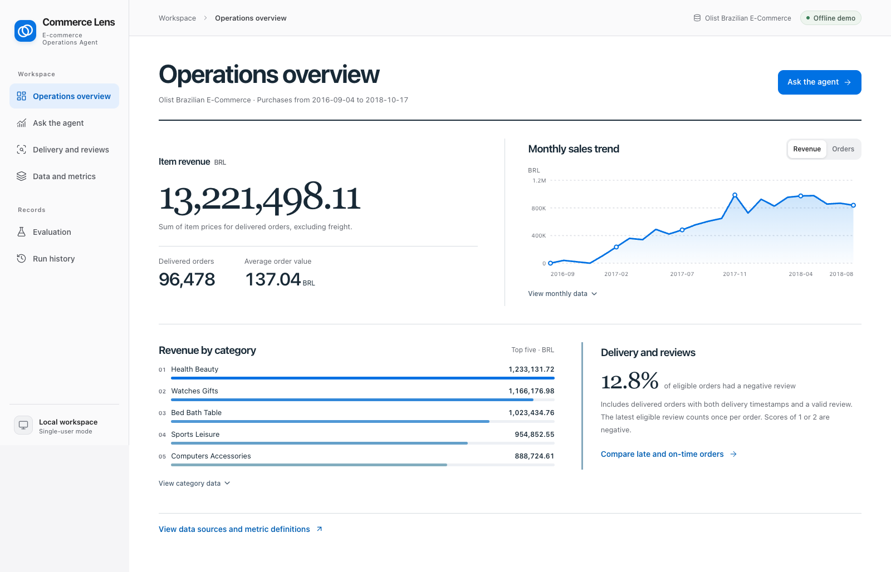

# E-commerce Operations Agent

**DSC 200 · Data Science Programming · Fall 2026**
Commerce Lens is the local workbench for the *E-commerce Operations Agent* project. It helps small online retailers answer two questions about Olist's Brazilian marketplace: which products and periods generated sales, and how often late orders received a negative review. Each analysis includes the executed SQL and its data snapshot.

**The published walkthrough uses demo mode and real Olist data.** Demo mode uses a small set of supported questions without calling a language model. The model endpoint, model ID and API key are configurable. The dataset and the choice of query mode are independent.

[Four-page project update (PDF)](docs/course/project-update.pdf) · [English web walkthrough (MP4)](https://raw.githubusercontent.com/Romanticjojo/ecommerce-operations-agent/main/docs/media/K03-workbench.mp4) · [Complete project ZIP](https://github.com/Romanticjojo/ecommerce-operations-agent/releases/download/v1.0.0/commerce-lens-v1.0.0.zip)



## Run the course dataset locally

Install Docker with Docker Compose. From the repository root, run:

```sh
docker compose build
docker compose run --rm workbench python -m commerce.cli olist
docker compose up -d --wait
```

Open [the workbench](http://127.0.0.1:8731). The import downloads **version 2** of `olistbr/brazilian-ecommerce` through KaggleHub, builds a local DuckDB database and installs it into the shared Compose volume. The first import requires internet access. Subsequent starts only need `docker compose up -d --wait`. The overview identifies the dataset currently loaded. Use `docker compose down` to stop.

For a native installation on macOS or Linux, use Python 3.11 and Node.js 22:

```sh
python3.11 -m venv .venv
.venv/bin/python -m pip install -r evaluation/kaggle_olist/requirements.txt
.venv/bin/python -m commerce.cli olist
./scripts/start.sh
```

The native script builds the frontend and serves it on port 8731. Set `PORT` to choose another port and `LENS_HOME` to choose the local database directory (default `runtime/`). Native and container installations use separate storage. If you already have the official CSVs, use `.venv/bin/python -m commerce.cli import /path/to/unzipped-olist`. To try the UI without the Kaggle download, starting an empty installation without the import creates a small synthetic fixture. All course figures below use Olist v2.

## Data scope and worked examples

The **Brazilian E-Commerce Public Dataset by Olist** contains anonymized marketplace orders. Version 2 has **99,441 orders**, purchased from **September 4, 2016 through October 17, 2018**. These are partial calendar years. We retain orders, items, payments, customers, products, sellers and reviews as separate relations. The category translation CSV supplies English labels. The ninth CSV, geolocation, is audited for its row count and fingerprint. It is outside both analytical workflows. [Official dataset and data license](https://www.kaggle.com/datasets/olistbr/brazilian-ecommerce) · [Data dictionary](docs/data-dictionary.md)

| Task | How to reproduce it in the English UI | Olist v2 result or interpretation |
|---|---|---|
| Reconcile sales | Ask **What is total item revenue?** Open the query evidence. | **BRL 13,221,498.11** across 96,478 delivered orders. The figure sums item prices and excludes freight. Item and payment totals are aggregated separately. |
| Compare products over time | Ask **Show the top 10 product categories by item revenue in 2018.** Switch from chart to table. | Ranks categories by delivered item revenue within the recorded portion of 2018. Date filters use purchase time, with an exclusive end date. |
| Investigate negative reviews | Open the delivery investigation and run the timestamp comparison. Repeat with the calendar-day definition. | Among 95,824 eligible reviewed orders, 4,142 of 7,661 late orders and 8,130 of 88,163 on-time orders scored 1–2. The difference was **44.84 percentage points**. The comparison establishes an association. |

The primary review analysis selects one eligible review per delivered order and requires valid scores plus actual and estimated delivery times. Group denominators, the 95% confidence interval and exclusions are available in the investigation. The dataset does not establish why an individual customer gave a low score. Live storefront actions, causal estimates and automated interventions are outside this course project.

## Configure a language model

The agent accepts an OpenAI-compatible Chat Completions endpoint. In the **project root**, next to `compose.yaml`, copy `.env.example` to `.env` on first setup and edit the local file.

```dotenv
LLM_BASE_URL=https://api.example.com/v1
LLM_MODEL=your-provider-model-id
LLM_API_KEY=your-local-key
```

Use the provider's **base URL**, including any required version prefix. The adapter appends `/chat/completions`. Set the exact **model ID** supported by the provider. The **API key** can be empty for a local endpoint that accepts unauthenticated requests. When using Docker, the endpoint must be reachable from the container. Keep credentials out of Git.

Recreate the container with `docker compose up -d --force-recreate --wait`, or restart `./scripts/start.sh` for a native installation. Open the mode control in the upper right to check the configured model ID. Submit a sales question and inspect its evidence to verify a real call. The agent sends the question and analytical schema to the provider. It compiles the returned plan and executes the query against local reporting views.

## Reproduce the checks

From the project root with the native environment installed:

```sh
.venv/bin/python -m pytest -q tests
.venv/bin/python -m pytest -q evaluation/kaggle_olist/cases.py --olist-version 2
.venv/bin/python -m commerce.cli evaluate --mode reference
.venv/bin/python -m commerce.cli evaluate --mode demo --output runtime/demo-report
```

The application suite checks imports, statistics, query restrictions, model-adapter contracts and HTTP behavior. The 15 Kaggle acceptance cases run a real local API against a fresh snapshot and compare it to calculations from the original CSVs. The 55-question benchmark is a separate experiment. Measuring real-model direct-SQL versus structured-plan accuracy requires a configured provider and `python -m commerce.cli evaluate --mode model`. Human review of the benchmark and real-model evaluation remain pending. [Acceptance report](evaluation/kaggle_olist/verified/REPORT.md) · [Runnable test package](evaluation/kaggle_olist/olist-kaggle-acceptance.zip) · [Recorded K03 test (MP4)](https://raw.githubusercontent.com/Romanticjojo/ecommerce-operations-agent/main/evaluation/kaggle_olist/media/K03-revenue.mp4)

## Course and engineering materials

| Material | Location |
|---|---|
| Project update, requirements selected for grading, three UML diagrams and six selected tests | [PDF](docs/course/project-update.pdf) · [Editable source](docs/course/project-update.md) |
| Requirements, architecture and acceptance criteria | [PRD](docs/PRD.md) · [Architecture](docs/architecture.md) · [Acceptance plan](docs/acceptance.md) |
| Data model, metric definitions and local operation | [Data dictionary](docs/data-dictionary.md) · [Operator guide](docs/operator-guide.md) |
| Check-in status, limitations and design decisions | [Verification](docs/verification.md) · [Project status](docs/project-status.md) · [Design](DESIGN.md) · [Source review](docs/source-review.md) |

The project update reserves the personal reflection for the students, as required by the rubric. The team must confirm its actual work distribution before submission.

The code is distributed under the [MIT license](LICENSE). Olist publishes its dataset under CC BY-NC-SA 4.0. The repository distributes code, download instructions and aggregate results. Design references include [DB-GPT](https://github.com/eosphoros-ai/DB-GPT) and [DesignMD Apple](https://designmd.me/discover/apple).
