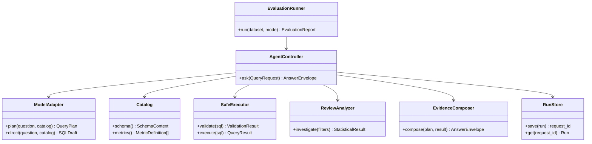
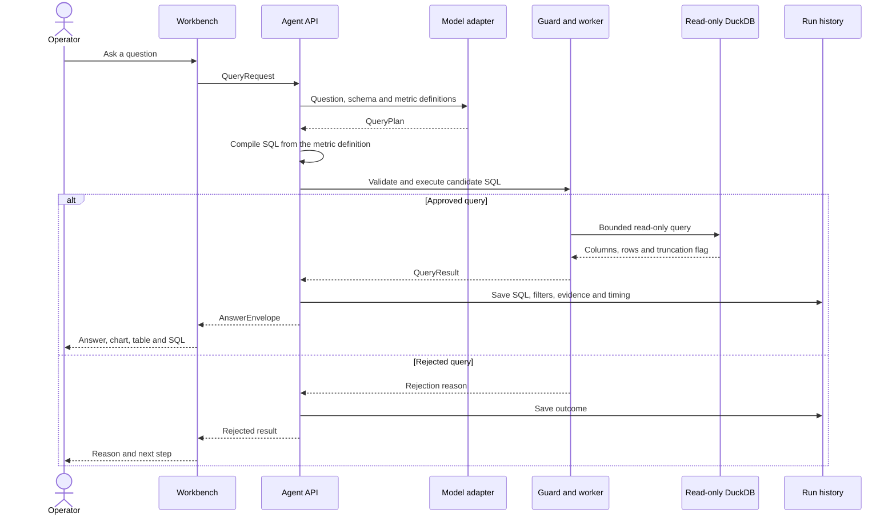
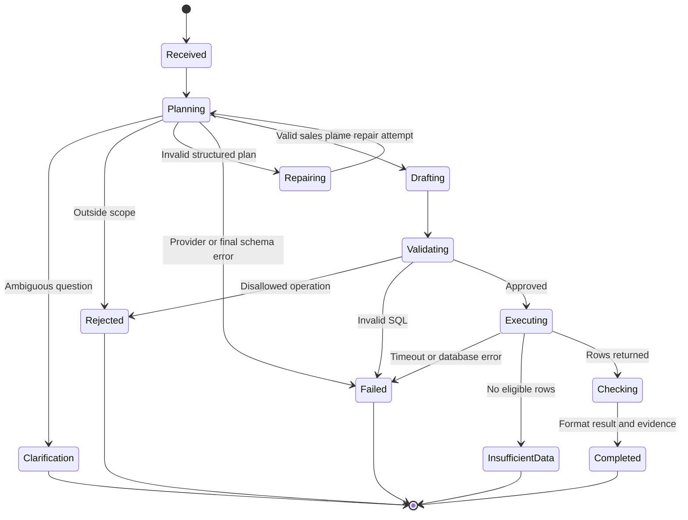
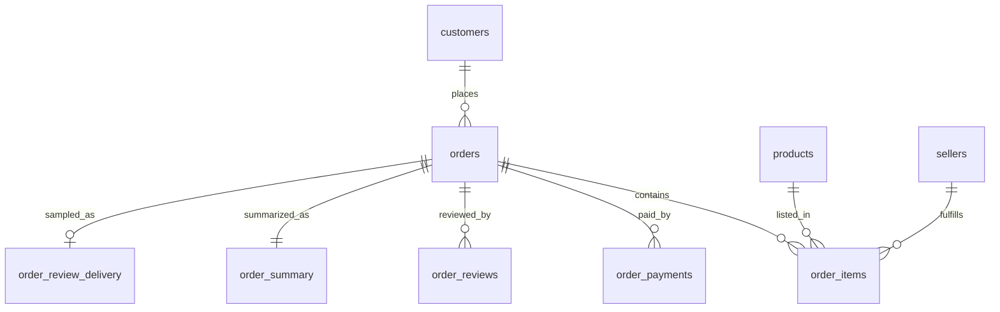

# Architecture and UML

Commerce Lens uses one controller. In full model mode a provider returns a bounded plan and the application compiles it into SQL. The direct baseline asks the provider for candidate SQL. Both use the same reporting views and execution limits. The first three diagrams address the UML portion of the course rubric. The entity-relationship diagram documents the data model.

## 1. UML class diagram of analytical contracts

Each box describes a logical interface implemented by Python modules. The class view shows which interfaces can be tested independently. Candidate sales SQL passes through the guard. The review analyzer owns fixed, read-only statistical queries and records them in its evidence.

## 2. UML sequence diagram of a sales request

The sequence view shows when a proposed plan becomes an executed query, which component reads the snapshot and when evidence is saved. Clarification can finish upstream during planning. The offline demo uses a local parser at the planning step.

## 3. UML state diagram of a request

The state view identifies terminal outcomes a user can encounter and the single permitted schema repair. It helps reviewers check that a timeout or empty sample reaches the right UI state. Statistical investigations take their own fixed-query path.

## 4. Entity-relationship diagram

The relationships describe the intended grains. Import audits test the actual keys, cardinalities and missing links. Aggregating items and payments independently avoids multiplying revenue. Choosing one eligible review per order supplies the unit of analysis for inference. Olist v2 also supplies the imported category translation and audit-only geolocation file. [Data dictionary](data-dictionary.md)

## Deployment

FastAPI serves the built React workbench and its API from one origin. Analytical requests read a DuckDB snapshot and write history to a separate local SQLite database. When configured, the model adapter calls the operator's chosen endpoint. Local CLI commands handle imports and batch evaluation. Native and Docker startup bind to the loopback interface by default.

## Named analysis procedures

The workbench reads skill descriptions and steps from `GET /api/skills` and submits the selected procedure ID and canonical question to `POST /api/query`. The controller checks the ID, date bounds and question before running the packaged read-only query locally. In model mode the full planner can also choose an allowlisted procedure and include supported dates. The direct SQL baseline retains its original reporting-view restrictions. Each procedure returns its executed query, table, conclusion, scope and interpretation notes in the existing history envelope. The model receives no stored review text or warehouse rows.
