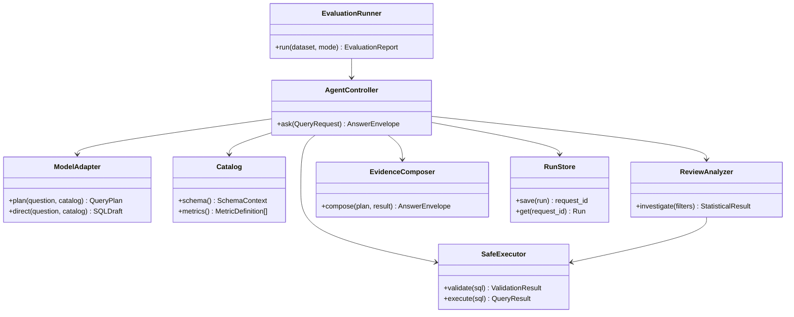
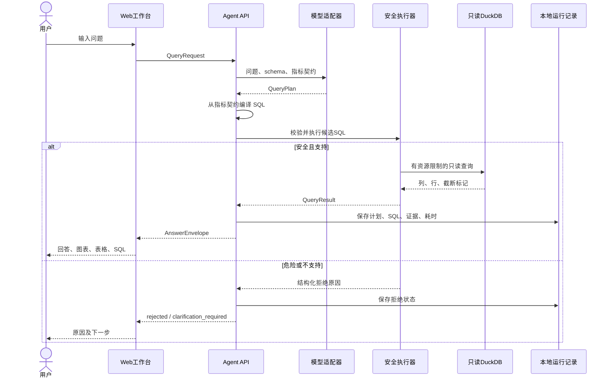
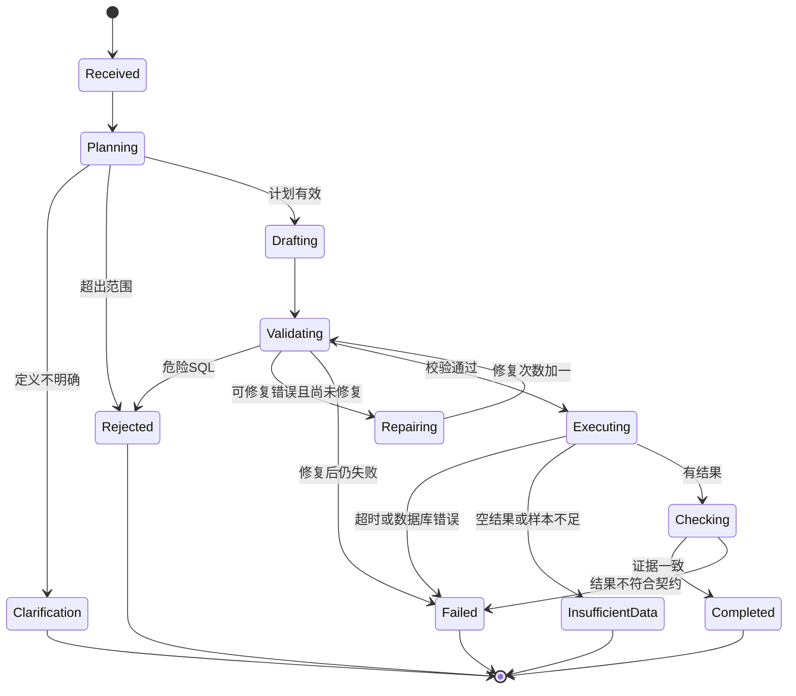
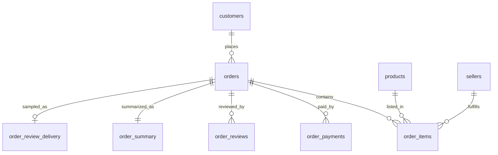

# 系统架构与 UML

首版采用下列模块边界。完整模式先让模型生成结构化计划，再由后端编译 SQL。Direct 对照模式由模型直接生成候选 SQL。数据流遵循“受控生成、确定性执行、有证据回答”。三个 UML 图类型用于对应课程要求；ER 图作为数据补充。

## 1. UML 类图：模块契约

含义：说明各模块对外方法和依赖，类名表达契约，不强制所有实现都使用类。选择类图是为了让前后端/数据/模型开发者知道可以独立替换哪些边界，防止控制器变成混杂的单文件。

## 2. UML 时序图：一次销售查询

含义：一次请求跨越 UI、模型、工具、数据库与证据存储的顺序。选择时序图是为了明确模型不能直连数据库、失败也要记录，以及前后端响应边界。可修复的语法/字段错误最多走一次修复，危险请求不通过修复绕过约束。

## 3. UML 状态图：请求生命周期

含义：显式列出成功、澄清、拒绝、数据不足和失败。选择状态图是为了验证有限重试与 UI 状态，避免无限 Agent 循环或错误状态显示为成功。

## 4. 数据 ER 图

这是目标关系，不是对未导入原始数据质量的断言；导入审计检验实际主外键、基数和缺失。order_summary 聚合金额避免商品与支付互相放大；order_review_delivery 保持主检验订单独立性。

## 部署组成

浏览器 → 同源 FastAPI（静态前端与 API）→ 单 Agent 服务。服务读取 DuckDB 数据快照并将运行记录写入独立本地存储；模型适配器仅在配置后访问指定服务。CSV 导入是独立本地管理命令；分析数据库运行时只读。容器部署仍默认仅向本机开放。
