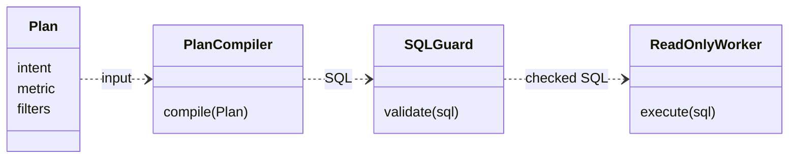
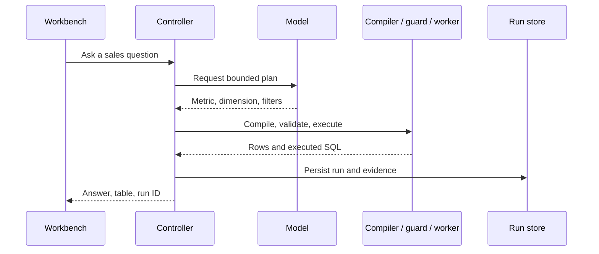
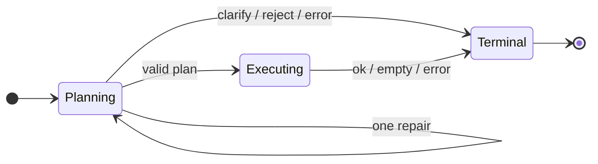

# E-commerce Operations Agent

DSC 200 · Project update · November 19, 2026

Which categories drive sales? Do late orders attract more negative reviews? Commerce Lens is a workbench for small online retailers using the Brazilian E-Commerce Public Dataset by Olist (2016–2018). The workbench aggregates items and payments separately so a multi-payment order cannot inflate sales. Each result includes the query behind it.

**Scope.** The workbench covers sales, delivery and review analysis, and evidence inspection. Live-store actions, causal attribution and multi-user hosting are outside scope. React displays results, FastAPI handles requests, DuckDB stores the snapshot and SQLite retains run history.

## Requirements selected for grading

All six are P0 release requirements. Stability is high for all except hardware-dependent NFR-03 (medium).

| ID | Verifiable requirement | Check |
|---|---|---|
| FR-01 | Answer supported sales questions with a correctly filtered table and a chart for grouped results. Default to delivered orders and report amounts in BRL. | UT-01, FT-01 |
| FR-02 | Compare eligible late and on-time orders by purchase period. Return group counts, rates, risk difference, 95% interval, test result and exclusions for either delivery definition. | UT-03, FT-02 |
| FR-03 | Give every accepted analysis request a retrievable run ID. Preserve executed SQL, snapshot, filters and outcome when applicable. Distinguish errors from empty results. | FT-01 to FT-03 |
| NFR-01 | Reject unsafe SQL and confine execution to read-only, resource-limited reporting views. Accept zero unsafe cases in the supplied safety suite. | UT-02, FT-03 |
| NFR-02 | Reimport identical inputs reproducibly. On a fixed, human-reviewed benchmark, target at least 90% result accuracy and 95% SQL success for a real model. | UT-01, benchmark |
| NFR-03 | Target local SQL p95 below 2 s at roughly 100,000 orders. Cap SQL execution at 15 s and returned rows at 1,000. | p95, FT-03 |

## Data model and storage

| CSV / DuckDB table | Grain and representative fields |
|---|---|
| orders | One order per order_id. Customer, status, purchase, actual and estimated delivery times. |
| order_items / order_payments | Order plus item sequence carries product, seller, price and freight. Order plus payment sequence carries method and value. Aggregate each table before joining totals. |
| order_reviews | One record per source row. Order, review ID, score, creation and answer times. Review IDs can recur across orders. |
| customers / products / sellers | One row per respective customer, product or seller key. Supply state, category and seller attributes. The category lookup maps Portuguese labels to English. |

Olist v2 has nine CSVs. The acceptance suite audited all nine. DuckDB imported the seven business tables and category lookup (eight files). Geolocation appears only in the audit. Checks cover hashes, row counts, nulls, foreign keys and repeated reviews. Monetary fields retain decimal cents. Dates use source-local time and half-open purchase periods. Item revenue sums item prices, excludes freight, and supplies the numerator for average order value.

<!-- page -->

# System architecture

## 1. Class diagram · analytical contracts

The classes describe logical contracts implemented by Python modules. The fixed compiler translates permitted model plans into SQL. The guard checks the parsed query before the isolated worker runs it. A class view makes the handoff and test boundary at each interface visible.

## 2. Sequence diagram · one successful sales query

The vertical order shows when execution, storage and display happen. It explains how a reader can retrieve the evidence behind a chart. The offline demo supplies the plan locally. A separate direct-SQL baseline uses the same execution guard for comparison.

## 3. State machine · result and recovery paths

Each question starts a fresh run. An invalid plan can trigger one schema repair. Unsupported requests return a terminal status. Execution can finish with rows, insufficient data or an error. The state view makes the retry limit and terminal outcomes explicit.

<!-- page -->

# Tests selected for grading

Six acceptance cases exercise the two analytical tasks, the evidence trail and failure recovery. Each case defines a repeatable input and an observable postcondition. Check-in results appear on the next page.

## Unit tests

### UT-01 · Keep item and payment totals independent

**Precondition** · An isolated fixture has one delivered order, two items priced BRL 10 and 20, and payments of BRL 12 and 18. **Steps** · Import, query the order and monthly views, then reimport the identical files. **Expected** · One order, BRL 30 item revenue, BRL 30 payment total and BRL 30 AOV on both runs. **Postcondition** · Snapshot identifiers match and the fixture is reusable.

### UT-02 · Enforce the SQL boundary

**Precondition** · Record the fixture database hash and prepare an external marker file. **Steps** · Submit prohibited writes, external reads and unsupported queries, then run an allowed aggregate. **Expected** · The prohibited cases fail, the marker stays private and the aggregate returns BRL 30. **Postcondition** · The database hash and marker contents match their starting values.

### UT-03 · Recover a known difference in review rates

**Precondition** · Twenty late orders include ten negative reviews. Twenty on-time orders include two. Add repeated reviews, ineligible scores and missing dates. **Steps** · Run the order-level analysis and compare it with hand counts and an independent SciPy test. **Expected** · Rates 0.50 and 0.10, difference 0.40, 95% interval about [0.116, 0.613], Pearson test. **Postcondition** · Each eligible order contributes once. Empty groups yield a null p-value.

## Functional tests

### FT-01 · Follow a category ranking back to its source

**Precondition** · Start the workbench on a known snapshot in offline mode. **Steps** · Ask for the top ten categories by 2018 item revenue, switch chart and table, then inspect the SQL and saved run. **Expected** · Delivered-only BRL totals agree with an independent ranking for the purchase year. **Postcondition** · The run ID retrieves the original SQL and snapshot.

### FT-02 · Switch from timestamps to calendar dates

**Precondition** · The dataset includes an order delivered after midnight on its promised date. **Steps** · Run the investigation twice over the same period, switching from timestamp to calendar day. **Expected** · That order moves from late to on-time. Both runs show sample sizes, rates, uncertainty, exclusions and the association limitation. **Postcondition** · Both definitions remain traceable and the total eligible count is unchanged.

### FT-03 · Recover after an unsuccessful request

**Precondition** · Save a working run and the database hash. Use a controlled provider for error scenarios. **Steps** · Request a causal explanation, an empty year and a prohibited operation. Simulate authentication failure and a timeout, then submit a valid question. **Expected** · Each has the appropriate clarification, empty, rejection or error state. The valid question succeeds. **Postcondition** · Evidence remains retrievable and the database hash is unchanged.

<!-- page -->

# Code check-in

## What the snapshot shows

The Olist snapshot contains **99,441 orders**. Of these, 96,478 were delivered, with **BRL 13,221,498.11** in item revenue and BRL 137.04 average order value. An independent pass over the CSVs using decimal arithmetic verified both revenue and payment totals.

| Delivery definition | Negative / late orders | Negative / on-time orders |
|---|---:|---:|
| Actual timestamp after estimated timestamp | 4,142 / 7,661 (54.07%) | 8,130 / 88,163 (9.22%) |
| Actual date after estimated date | 3,983 / 6,381 (62.42%) | 8,289 / 89,443 (9.27%) |

The Olist snapshot covers September 2016 to October 2018. Both comparisons use 95,824 eligible orders. The timestamp risk difference was **44.84 percentage points** (95% Newcombe-Wilson interval 43.71 to 45.97). Scoring 1 or 2 of 5 counts as negative. Each order contributes its latest eligible review. For 525 orders, multiple reviews qualified. Selection into the reviewed sample and unmeasured order differences limit causal interpretation.

## Progress against the requirements

| Requirement | Evidence at this check-in |
|---|---|
| FR-01 to FR-03 | Implemented. The original engineering check-in passed 17 Python tests. Fifteen further acceptance cases passed on Olist v2, using independently computed CSV results and the offline planner. Tests include persisted SQL, filters, snapshot and lookup by run ID. |
| NFR-01 | The safety suite rejected its prohibited cases. The allowed query succeeded and the fixture database hash stayed unchanged. |
| NFR-02 | Repeat import and rollback passed. The 55-question evaluation has 50 raw-table reference queries and five expected-status cases. Human review and real-model direct/full runs are pending. |
| NFR-03 | Timeout recovery and 1,000-row truncation passed. A local Mac run of 50 distinct reference queries measured SQL p95 of 16.68 ms. A run on specified target hardware and real-model end-to-end timing are pending. |

**Test disposition.** UT-01 to UT-03 passed. For FT-01 and FT-02, Chrome exercised a real Olist query, result table, SQL copy, JSON download, investigation and saved history. All six routes loaded at 390, 768 and 1,440 px with no browser script errors. FT-03 failure and recovery paths passed component and API checks using controlled inputs.

**Spec change.** The full model now emits a typed plan for a deterministic compiler. This narrows the set of possible queries and makes sales definitions testable.

## Work distribution and remaining student input

Proposed roles for team confirmation are data and statistics (imports and inference), application engineering (planning and workbench), and quality and release (acceptance and publication). The team should confirm its actual assignments before submission.

**Student reflection · pending.** Each team should supply its own one or two paragraphs on the development experience, a challenge or surprise, and what it learned. This section is reserved for that account.

[Project source and reproducibility instructions](https://github.com/Romanticjojo/ecommerce-operations-agent) · [Olist data source](https://www.kaggle.com/datasets/olistbr/brazilian-ecommerce)
